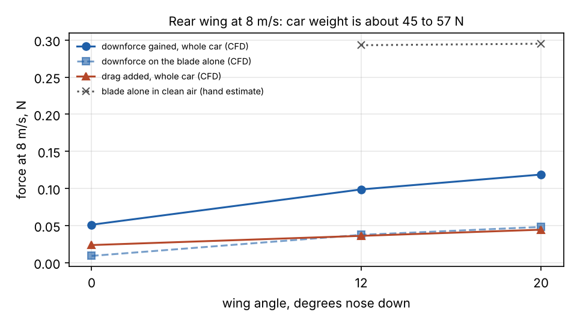

# Car 1 v2: aerodynamics and cooling

The question this page answers: does the shape of the car matter at the speeds it drives, should it carry
the rear wing from the printed kit, and do the electronics get enough air.

Short answers:

- **Air does not matter at today's speeds.** At the 2 m/s cap the air pushes back with about 0.1 N and lifts
  the car by about 0.04 N. The car weighs about 45 to 57 N (4.5 to 5.8 kg, `sim/perf/mass.py`).
- **It still matters little at race speed.** At 13.5 m/s, the top of the speed range in
  `docs/PERFORMANCE.md`, drag is 4.5 N (61 W) and the body lifts by 1.6 N, about 3 % of the weight.
- **The wing is left off.** In the model the kit's wing adds at most 0.12 N of downforce at 8 m/s, 0.34 N at
  13.5 m/s and about 0.007 N at 2 m/s. It is plastic at the highest point at the back of the car and two posts in the lidar's
  rear view, for nothing measurable.
- **Cooling is the fans' job, not the car's speed.** The pressure the car's motion makes across the vents is
  about 2 Pa at 2 m/s. The vent area in the pods is enough for the air the electronics need.

Everything below is a computer model. Nothing here was measured on a car or in a wind tunnel.

## What was modelled

The model is built by script from the same CAD that makes the printed parts, so it follows the design:

- `sim/aero/make_geometry.py` puts together the printed kit (`mech/kit.py`, `mech/extras.py`), the car 1 v2
  mounts with the RPLidar C1 and the OAK-D Pro (`mech/car1v2.py`), the chassis and four tyres, and writes the
  surfaces the solver needs. The car is 0.488 m long. Its frontal area is 0.0364 m2 without the wing.
- `sim/aero/run_cfd.py` runs each case in OpenFOAM v1912: steady flow, the k-omega SST turbulence model, air
  at 8 m/s, the ground moving under the car at the same speed. The box of air is 2.5 x 1.2 x 0.7 m (the car
  blocks 4.3 % of its cross-section). Cells are 5 mm on the car and 1.25 to 2.5 mm on the wing, 270,000 to
  350,000 cells a case, 500 iterations.
- `sim/aero/foam_forces.py` adds up the pressure on every surface cell to get the forces.
  `sim/aero/summarize.py` makes the tables on this page. `sim/aero/vent_pressure.py` reads the pressure where
  the vents are.

Four cases were run: no wing, and the kit's wing at 0, 12 and 20 degrees nose down. The wing is the blade in
`mech/kit.py`: a flat plate 45 mm deep and 190 mm wide with end plates, 0.23 m above the ground at the tail.
The kit holds it flat. The two tilted cases turn the blade about its mid-chord line in the model only, to see
whether a tilted wing would be worth making.

## Results at 8 m/s

| case | cells | drag N | lift N (+ is up) | drag change N | downforce gained N | on the wing alone: drag N, downforce N |
| --- | ---: | ---: | ---: | ---: | ---: | --- |
| no wing | 267,356 | 1.58 | +0.56 | +0.000 | +0.000 | - |
| wing flat (0 deg) | 345,958 | 1.60 | +0.51 | +0.024 | +0.051 | 0.018, 0.009 |
| wing nose down 12 deg | 350,790 | 1.62 | +0.46 | +0.036 | +0.099 | 0.030, 0.037 |
| wing nose down 20 deg | 350,646 | 1.63 | +0.44 | +0.044 | +0.119 | 0.041, 0.048 |



How to read it:

- The car without a wing has a drag coefficient of about 1.1 on its frontal area. That is a brick, which is
  what an open-wheel car with a lidar and a camera on a mast looks like to the air. It also lifts slightly.
- The blade itself makes 0.04 to 0.05 N of downforce when tilted. The whole car gains about twice that,
  because the wing also changes the pressure on the deck in front of it.
- The force on the body changes by about 0.04 N just from re-meshing with a wing present, and it wobbles by
  0.01 to 0.015 N over the last iterations. So the flat-wing row (0.05 N gained) is inside the noise, and the
  tilted rows are only a little outside it.
- A hand estimate for the same blade alone in clean air, with no car in front of it, gives about 0.3 N at
  8 m/s (finite-wing lift slope, capped at a lift coefficient of 0.9 because a flat plate stalls). The model
  gives a sixth of that. Part of the gap is real: the blade sits behind the camera arch and the canopy, in
  slow, disturbed air. Part is the coarse mesh. The truth is somewhere between, and both ends are small.

## At the speeds the car drives

Forces scale with the square of the speed. The car has not been weighed (checklist B10), so the shares use
the range from the mass budget in `sim/perf/mass.py`, 4.54 to 5.76 kg.

| speed | drag, no wing | power to push the air | lift, no wing | lift as a share of the weight | what the 20 deg wing adds |
| --- | ---: | ---: | ---: | --- | --- |
| 2 m/s | 0.10 N | 0.2 W | +0.035 N | 0.06 to 0.08 % | 0.007 N (0.01 to 0.02 %) |
| 5 m/s | 0.62 N | 3.1 W | +0.219 N | 0.39 to 0.49 % | 0.046 N (0.08 to 0.10 %) |
| 8 m/s | 1.58 N | 12.7 W | +0.561 N | 0.99 to 1.26 % | 0.119 N (0.21 to 0.27 %) |
| 11 m/s | 2.99 N | 32.9 W | +1.060 N | 1.88 to 2.38 % | 0.224 N (0.40 to 0.50 %) |
| 13.5 m/s | 4.50 N | 60.8 W | +1.597 N | 2.83 to 3.59 % | 0.338 N (0.60 to 0.76 %) |

2 m/s is today's speed cap, 5 m/s a fast lap, 8 m/s the speed the model ran at, 11 m/s the fastest published
competition cars and 13.5 m/s the limit set in `docs/PERFORMANCE.md`. For the wing to add even 5 % to the
tyres' load, the car would have to go about 35 to 39 m/s by the model, or about 22 to 25 m/s by the kinder
hand estimate. Grip on this car comes from tyres, weight and where the weight sits. The one aerodynamic
effect worth remembering at race speed is the lift: 1.6 N at 13.5 m/s takes about 3 % off the grip.

## What this changed in the design

1. **No wing in stage 1.** `wing_blade` and the two `wing_strut` parts are not printed. That is about 80 cm3
   of plastic that would sit at the highest, rearmost point of the car, and one less part to break in a
   crash. The print plate that held the blade and the pack lid (3 h 34 m in `mech/PRINTING.md`) is not needed
   at all, since this car has no pack lid either. The four wing inserts in the rear deck stay empty.
2. **A clearer view behind for the lidar.** The RPLidar C1 sees all the way round, unlike the SICK lidar the
   kit was drawn for. The two wing posts stand in its scan plane at the tail. Without them the only things
   in the rear view are the camera arch's legs and the canopy legs (checklist B9).
3. **The wing stays in the CAD.** If the team wants it for looks or as a place for a sponsor's name, it
   costs nothing in performance either way at these speeds. Fit it as drawn, flat. The kit's struts hold it
   at 0 degrees only; tilting it would need new struts, and the model says they are not worth drawing.
4. **Nothing else was reshaped.** A smoother nose or covered wheels would cut drag, but drag is 0.2 W at
   2 m/s and 61 W at 13.5 m/s, where the motor is taking about 700 W. Mass and a low centre of gravity are worth
   more: keep the LiPo low in the chassis bay, as the design already does.

## Cooling

What the electronics give off: the Jetson in its 25 W mode, plus an allowance of 10 W for the ESC and the
power board at cruising current. The 10 W is a round number, not a measurement. To carry 35 W away with the
air warming by 10 C takes 2.9 litres of air a second (6.1 cubic feet a minute).

- **Vent area.** The side pods have twelve open slots between them (seven in the left pod, five in the right,
  240 mm2 each): 28.8 cm2. 2.9 l/s through that is 1.0 m/s, which costs almost no pressure. The area is
  enough.
- **What moves the air.** The model gives the pressure on the outside of the car where the openings are, as
  a fraction of the dynamic pressure: +0.47 on the forward-facing surfaces above the deck, -0.32 on the
  outer walls of the pods where the slots are, -0.40 on top of the canopy, -0.19 at the back. So the car's
  motion wants to push air in at the front and pull it out through the pod slots. The pressure available
  for that is 1.9 Pa at 2 m/s, 12 Pa at 5 m/s and 30 Pa at 8 m/s. At today's speeds that is nothing. The
  dev kit's own fan and the 40 mm pod fan do the work, and the car cools the same standing still as moving.
- **One thing to know for later.** The pod fan is drawn blowing inboard, taking its air through the right
  pod's outer slots. At speed those slots are in suction, so the car's motion works against the fan: by
  0.8 Pa at 2 m/s, which does not matter, and by 12 Pa at 8 m/s, which might. If the car ever runs that
  fast and the ESC runs warm, turn the fan round so it blows out through the pod. Do not change it now.
- **The canopy.** It sits 8.4 mm above the Jetson's fan in the kit model. That gap came from an estimated
  heat-sink height (MEASURE_FIRST item 18). If the Jetson throttles with the canopy on and not with it off,
  the gap is the first thing to raise.

The check that settles it is on the car, not in the model: checklist E9, ten minutes at full load with the
canopy on, reading the Jetson's own temperatures.

## What the model leaves out

- **Friction on the surfaces.** Only pressure is added up. On a shape this blunt, friction adds a few percent
  to drag.
- **A fine mesh.** No thin cell layers at the walls, and one mesh size only. No second, finer run was made to
  see how much the numbers move. Treat the drag as good to perhaps 20 % and the wing numbers as "small",
  not as values.
- **Turning wheels.** The ground moves, the tyres do not turn.
- **Air through the car.** The body is closed in the model: no flow through the vents, the pods or under the
  canopy. The vent pressures say which way air would go, not how much.
- **Cables, the antenna, the E-stop button, the real body shell.** Not in the geometry.
- **One speed.** The other speeds are scaled by speed squared. The flow's character changes little between
  2 and 8 m/s for a blunt shape, but that was assumed, not run.
- **The air data.** Density 1.2 kg/m3 and viscosity 1.5e-5 m2/s, round numbers for room air.

## Run it again

On Linux with OpenFOAM v1912 from the Ubuntu package (`apt install openfoam`) and Python with CadQuery,
trimesh and numpy:

```
python3 sim/aero/make_geometry.py              # geometry from the CAD
python3 sim/aero/run_cfd.py nowing 8           # about 25 minutes a case on two cores
python3 sim/aero/run_cfd.py wing_0 8
python3 sim/aero/run_cfd.py wing_m12 8
python3 sim/aero/run_cfd.py wing_m20 8
python3 sim/aero/vent_pressure.py
python3 sim/aero/summarize.py                  # tables, summary.json, the plot
```

The case folders (about 130 MB each) are not kept in the repository. `sim/aero/out/results.json`,
`summary.json` and `vent_pressure.json` are. One trap: this OpenFOAM build fails when force-reporting
"function objects" are switched on, which is why the forces are added up by `foam_forces.py` instead.

## Check it in SOLIDWORKS Flow Simulation

The team's SOLIDWORKS sponsorship arrived on Nov 9. Flow Simulation is the add-in that does this kind of
study. Running the same cases there is a good first project and an independent check on the numbers above.
This set-up was written from the add-in's normal workflow and has not been run, so menu names may differ a
little in your version. Check first that Flow Simulation shows under Tools > Add-Ins; the sponsorship email
does not say which add-ins are included.

1. Open `sim/aero/out/step/car1v2_aero_no_wing.step` (and later `car1v2_aero_wing_0.step`). Units are
   millimetres. The nose points along +X, up is +Z, and the ground is the plane Z = 0. The tyres sink 2 mm
   into it on purpose.
2. Add a ground: a flat plate part, 2500 x 1200 x 10 mm, its top face at Z = 0, reaching 900 mm ahead of
   the car's origin and 1600 mm behind it.
3. Flow Simulation > Project > Wizard. Units SI. Analysis type **External**, with "Exclude cavities without
   flow conditions" and "Exclude internal space" ticked. Fluid: Air. Flow type: laminar and turbulent. Walls:
   adiabatic, roughness 0. Ambient conditions: 101325 Pa, 293 K, velocity in X = **-8 m/s** (the air comes
   at the nose).
4. Computational Domain: X from -1600 to +900 mm, Y from -600 to +600 mm, Z from 0 to 700 mm.
5. Boundary condition on the plate's top face: Real Wall, with wall motion set to a translation of -8 m/s in
   X. That is the road moving under the car.
6. Goals: Global Goal "Force (X)" and "Force (Z)". With the wing, also Surface Goals "Force (X)" and
   "Force (Z)" on the blade's faces.
7. Mesh: global level 4 to start, with a local mesh one or two levels finer in a box round the car. Then
   run level 5 and see how far the forces move. That is the mesh check this page is missing.
8. Run, and compare with the table: drag is -Force (X), lift is +Force (Z). To tilt the wing, rotate the
   blade body about its mid-chord line; `sim/aero/make_geometry.py` shows the pivot.

If Flow Simulation gives a drag within about 20 % of 1.6 N and a wing effect that is still a small fraction
of a newton, the conclusion stands. If it does not, believe neither until a finer mesh agrees with one.
