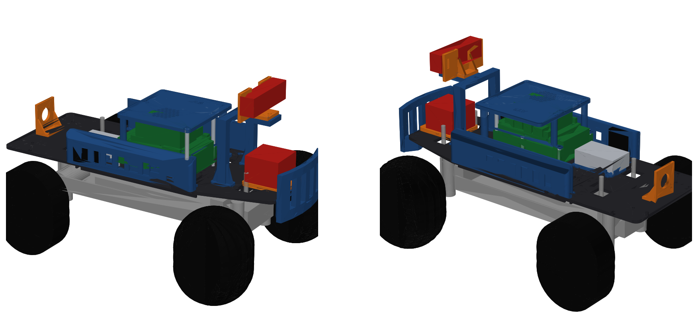

# Car 1 v2: quick start for the builders

The short version, as sent to the build team on 2026-11-09. The long versions are `docs/CAR1V2_BUILD.md` and
`docs/CAR1V2_CHECKLIST.md`.

The 3D model of car 1 v2 is `mech/out/car1v2/assembly/car1v2_assembly_step.zip`, with a picture next to it. Unzip it and open the .step file in SolidWorks, Fusion or Onshape. Every part has a name, so you can click on anything and see what it is. Orange is the new mounts, blue and black are the rest of the printed kit, green is the electronics, red is the lidar and camera.

The battery, the BMS and the fuse are not in the model because nobody has measured where they go yet. The E-stop bracket is drawn on the tail, but you pick the exact spot.

Nothing is ordered yet, so the power board and some small parts are not here. This is what can be done now and the order for the rest.

With what we already have:

1. Find the Slash 4x4 chassis with the Holmes motor on it. Count the teeth on the small gear on the motor and on the big gear it drives, and write both down. We want 15 and 54.
2. Write down what is printed on each 4S LiPo: capacity, C rating, whether it says LiPo or LiHV. Measure its length, width and height.
3. Print fit_coupon_front and fit_coupon_rear and check they sit on the chassis posts. If they don't, stop and tell Eshan before printing anything else.
4. Measure the four screw holes under the RPLidar C1 (distance between centers, both ways) and the two M4 holes on the back of the OAK-D camera. If you have to take one off car 1 to measure it, put it straight back.

Printing, all in PETG-CF (settings are in mech/PRINTING.md):

5. Print any time after the coupons fit: deck_front, deck_rear, the four splices, bumper, both side pods, camera_arch, canopy_leg, stack_canopy.
6. Wait for a measurement before these: deck_mid (battery size), devkit_tray (hole positions on the second Jetson), esc_cradle (size of the spare Flipsky), c1_plinth and oakd_cradle (step 4). estop_bracket and bms_fence_jk wait until the button and the BMS arrive. The four new parts are in mech/out/car1v2/stl.
7. Skip the wing, pack_box, pack_lid, the cell holders, and the old lidar_plinth, camera_cradle and bms_fence. The new parts replace them.

Putting it together, bottom to top like the model:

8. Deck pieces and splices onto the chassis posts. Then the bumper and the side pods.
9. ESC cradle and the spare Flipsky. Leave the three motor wires unplugged for now.
10. Power board on its 7 mm spacers. Then the metal bar and the clear shield over the three big transistors. Then the tray with the second Jetson, on the 25 mm standoffs.
11. The servo plugs into J406 on the power board, NOT into the Flipsky like on car 1. The Flipsky's servo wire goes to J904.
12. E-stop button in its bracket on the tail, two wires to J1001.
13. Lidar mount on the front of the deck, then the camera arch and cradle. The canopy goes on last, after the electronics have been tested.

Battery rules:

The LiPo lives in its bag when it is not in the car. Charge it only on the balance charger, with someone in the room.
Unplug the big yellow battery connector before you touch any wiring.
An adult is there the first time the power board is connected to the battery.
Wheels off the ground any time the motor can spin.

The lidar and camera stay on car 1 until everything else on the new car works. Moving them over is the last step.

The power board gets soldered when the bare boards arrive, and that has its own guide. The long version of everything is in the carv2 repo on GitHub, rev-b-tht branch: docs/CAR1V2_BUILD.md for the steps and docs/CAR1V2_CHECKLIST.md for the measurements. If the model and a real part disagree, the real part wins. Tell Eshan and the model gets fixed.
