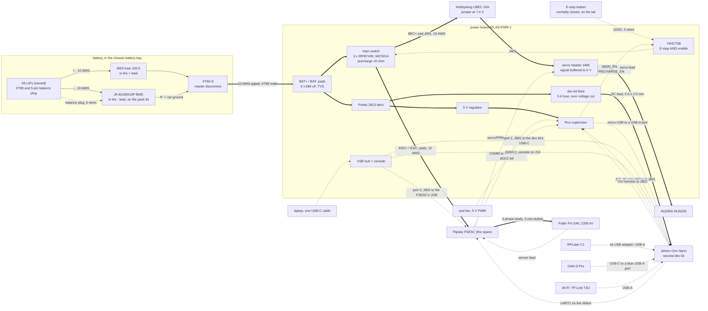

# Car 1 v2 wiring

Stage 1: the car drives on a 4S LiPo, an RPLidar C1 and an OAK-D Pro. The board is ATLAS-PWR-1 from rev B with
nothing changed in copper. `docs/WIRING.md` (rev B section) has the cable lengths for the rev B kit; this page
says what is different on car 1 v2 and gives the whole picture on one diagram. Dashed lines are signal, solid
lines carry power.

## What differs from the rev B wiring table

| connection | rev B | car 1 v2 stage 1 |
| --- | --- | --- |
| pack | built-in 4S3P 18650 pack, cell taps on a 7-pin lead | an owned 4S LiPo; its 5-pin balance plug goes to the BMS through an extension lead |
| BMS | JBD 4S 100 A, UART to J201 | JK-B1A8S10P. Its UART is left unconnected: it talks at 115200 baud and the board's optocouplers pass 9600. J201 stays empty. Cell voltages are read in the JK phone app |
| servo supply | Castle BEC 2.0 at 7.5 V | Hobbywing UBEC 10A set to 7.4 V, on the same pads (BEC+ J401 in, J403 out), with a 10 A in-line blade fuse in its red input lead. The latch's VIN lead gets a 7.5 A one. The board has no fuse on either |
| lidar | SICK TiM561: 12 V from J409, Ethernet through a USB adapter | RPLidar C1: one USB lead from its adapter board to a dev-kit USB-A port. J409 stays empty |
| camera | LUCID Triton: 12 V from the Pololu regulator, Ethernet on the dev kit's RJ45 | OAK-D Pro: one USB-C lead to a USB 3 port. The regulator (MOD402) is not fitted and its pads stay empty |
| charging | USB-C PD trigger and CC/CV module on the charge pads | not fitted. The LiPo comes out and goes on the balance charger. The charge pads stay empty; `CHG_PRESENT_N` rests high through its pull-up |
| E-stop | "a wire loop if no button is fitted" | a normally closed button on the tail bracket, wired to J1001. No loop jumper |
| Jetson | car 1's dev kit | the second dev kit, so car 1 keeps its own |

Everything else is as in rev B: the FSESC on the ESC pads and J903/J904, the dev-kit DC lead, the 40-wire
ribbon, the J14 harness, the Pico's USB lead, the three hub leads, the fan and the latch.

## Three things to get right

1. **The servo is fed from the UBEC, not from the FSESC.** On car 1 the servo plugs into the FSESC. On car 1 v2
   only the FSESC's signal wire is used: it goes to J904, the board buffers it, and the servo plugs into J406,
   where the red wire is the UBEC's 7.4 V. Do not plug the INJS235 straight into the FSESC.
2. **The balance plug goes to the BMS and nowhere else.** The pack's main leads go through the fuse and the BMS
   to the XT90-S. To charge, unplug both the XT90-S and the balance plug and take the pack to the charger.
3. **The E-stop loop is two wires and no ground.** One side is J1001 pin 1, the other pin 2. Keep them away
   from the motor leads and twist them.
