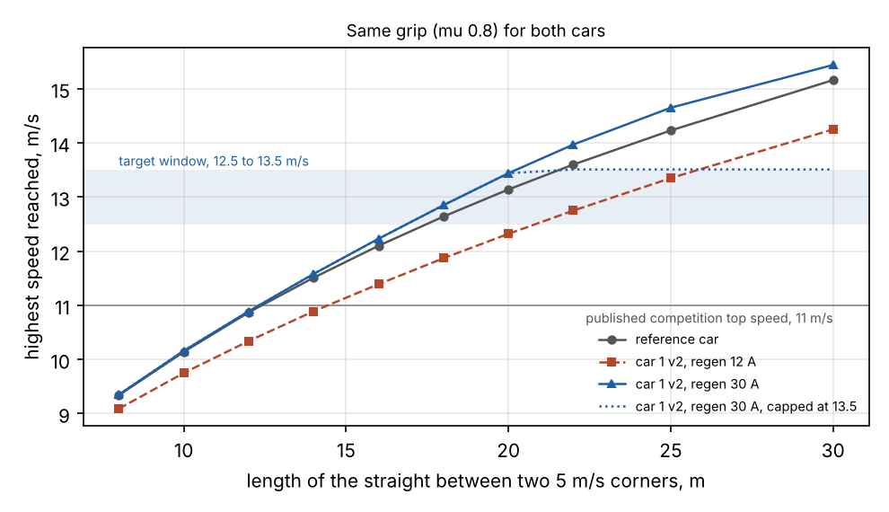
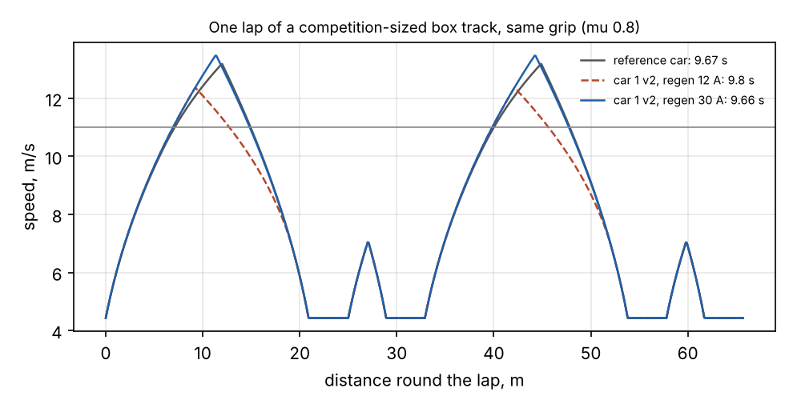

# Car 1 v2: how fast it can go, against the competition

The question (Ragini, 2026-11-09): with the car's real weight and parts in the simulation, can car 1 v2 go
1.5 to 2.5 m/s faster than its RoboRacer (F1TENTH) competition?

Short answers:

- **Yes for the car itself.** The fastest published competition cars reach about 11 m/s. The simulated car
  1 v2 reaches 12.5 m/s after 9 m of straight and 13.5 m/s after 11 m, and its top speed on a long straight
  is 15 to 18 m/s. With the set-up below, the speed limit in the motor controller is set to 13.5 m/s, so the
  car's range ends 2.5 m/s above the competition.
- **Three things had to change to get there**: the gearing (a 15-tooth pinion), the braking limit in the
  motor controller (30 A back into the battery, not 12 A), and the speed limit itself. None costs more than
  a pinion.
- **It does not make the car faster round a lap than a well-driven competition car.** A standard competition
  car has enough motor too. Both cars are held back by the same thing: tyre grip. On the same track with the
  same grip the two lap times are within 1 %. To pull ahead on a real track the car needs more grip, less
  weight and a faster lidar, in that order. This page says how much of each.
- **It is not safe to use yet.** At 13.5 m/s the car carries 46 times the energy it has at today's 2 m/s,
  the lidar sees a new scan every 1.35 m, and the hardware E-stop no longer stops the car in any useful
  distance. The software limit stays at 2 m/s until the things in "Before anyone drives it fast" are done.

Everything here is a model. Nothing was measured on a car. The model is in `sim/perf/`, and
`python3 sim/perf/run_all.py` reproduces every number on this page.

## What the competition runs at

| source | what it says |
| --- | --- |
| ForzaETH Race Stack (Baumann et al., Journal of Field Robotics 2025, arXiv 2403.11784). ForzaETH won the German Grand Prix 2022 and the ICRA Grand Prix 2023 | The car was run at up to 11 m/s, "over 10 m/s on tracks up to 150 m". Traxxas Slash 4x4 chassis, Velineon 3500 motor ("maximum power at 300 W"), VESC 6, a 5000 mAh LiPo, a Hokuyo lidar at 40 Hz, ARRMA belted tyres. Official tracks are about 30 m by 10 m |
| RoboRacer Sim Racing League at IROS 2026 (the league's results post on LinkedIn) | Winner: best lap 7.16 s, top speed "over 11 m/s". Third: 7.33 s and over 9.5 m/s. This is the simulator league, not real cars |
| TU Wien and Bologna race reports, 2024 | Best laps of 7.3 to 7.4 s on real tracks |

So the benchmark is **11 m/s**, and the target window is **12.5 to 13.5 m/s**.

One thing to know about that 11 m/s: it is what the best teams reach on the straights they are given. It is
not what their motors can do. The model below puts a standard competition car at 17 m/s on an endless
straight. Their speed is set by the track, the tyres and their software.

## The car in the model

| | car 1 v2 | reference competition car |
| --- | --- | --- |
| Mass | 5.15 kg, likely 4.5 to 5.8 (`sim/perf/mass.py`, not weighed) | 3.74 kg (the F1TENTH simulator's identified value) |
| Motor | Holmes Puller Pro 540, 2200 rpm per volt, 50,000 rpm limit | Traxxas Velineon 3500, 300 W as published |
| Battery | 4S LiPo, 60 A limit | 3S LiPo |
| Gearing | 15 / 54, overall 10.26 (see below) | 13 / 54, overall 11.82 (Traxxas stock) |
| Tyres | 109.5 mm (Traxxas figure for the stock tyres) | the same |
| Drag | 0.041 m2 drag area from the CFD (`docs/AERO.md`) | the same |
| Grip | mu 0.8, the same for both | |

The mass is new and it is higher than the 3 to 4 kg guessed earlier. Bottom-up it comes to 5.15 kg: about
2.0 kg of rolling chassis, 0.88 kg of printed parts, 0.52 kg of battery, 0.30 kg of BMS, and 1.45 kg of
everything else. Only the motor's 210 g was read on a maker's page. The rest are estimates, and the range
allows for that. Weighing the car is checklist item B10.

Estimates that matter, all in `sim/perf/params.py` with their basis: grip (mu 0.8), the motor's winding
resistance (0.030 ohm; Holmes does not publish it), the resistance of the pack and wiring (0.025 ohm),
drivetrain efficiency (0.85) and rolling resistance (0.02). The "worst case" below sets all of them against
the car at once.

## Result 1: top speed, and why the pinion changes

Top speed on an endless straight is where the motor's back-voltage meets what the sagging battery can still
push. Gearing moves it.

| pinion / spur | overall ratio | top speed: worst case | nominal | best case | launch force at 60 A | grip at mu 0.8 | motor rpm at 13.5 m/s |
| --- | ---: | ---: | ---: | ---: | ---: | ---: | ---: |
| 13 / 54 | 11.84 | 13.6 m/s | 14.5 m/s | 15.9 m/s | 47.9 N | 40.4 N | 27,875 |
| 14 / 54 | 10.99 | 14.5 m/s | 15.6 m/s | 17.1 m/s | 44.4 N | 40.4 N | 25,884 |
| 15 / 54 | 10.26 | 15.3 m/s | 16.6 m/s | 18.2 m/s | 41.5 N | 40.4 N | 24,158 |
| 16 / 54 | 9.62 | 16.2 m/s | 17.5 m/s | 19.3 m/s | 38.9 N | 40.4 N | 22,649 |

Worst case: a 5.76 kg car, the pack at 3.5 V a cell, both resistances at the top of their range. Best case:
4.54 kg, 4.0 V a cell, low resistances.

- The Traxxas stock gearing (13 / 54) reaches the window, but in the worst case it has 0.1 m/s to spare at
  13.5. That is no margin.
- **15 / 54 is the choice.** It clears 13.5 m/s by 1.8 m/s in the worst case, and at 60 A the motor still
  pushes as hard as the tyres can grip (41.5 N against 40.4 N). 16 / 54 would give up launch force.
- Nobody has looked at which pinion and spur are on the donated chassis (checklist A4). The motor has a
  3.175 mm (1/8 in) shaft, so the pinion is a 32-pitch, 15-tooth one with that bore, not a Traxxas pinion
  (those are for 5 mm shafts). It is in `bom/car1v2/cart_other.csv` as an estimate of $8.
- The motor turns 24,158 rpm at 13.5 m/s, under half of its 50,000 rpm limit.

## Result 2: how much straight it takes

Flat out from a 5 m/s corner, no braking:

| grip | to 12.5 m/s | to 13.5 m/s |
| --- | --- | --- |
| mu 0.6 (a slippery floor) | 12.5 m, 1.4 s | 15.2 m, 1.6 s |
| mu 0.8 | 9.1 m, 1.0 s | 11.0 m, 1.2 s |
| mu 1.05 (the F1TENTH simulator's default) | 8.9 m, 1.0 s | 10.7 m, 1.2 s |

On a race track the car also has to slow down again for the next corner. The highest speed reached on a
straight between two 5 m/s corners, same grip for both cars:

| straight between two 5 m/s corners | 8 m | 10 m | 12 m | 14 m | 16 m | 18 m | 20 m | 22 m | 25 m | 30 m |
| --- | ---: | ---: | ---: | ---: | ---: | ---: | ---: | ---: | ---: | ---: |
| reference car | 9.3 | 10.1 | 10.9 | 11.5 | 12.1 | 12.6 | 13.1 | 13.6 | 14.2 | 15.2 |
| car 1 v2, regen 12 A | 9.1 | 9.8 | 10.3 | 10.9 | 11.4 | 11.9 | 12.3 | 12.8 | 13.3 | 14.2 |
| car 1 v2, regen 30 A | 9.3 | 10.2 | 10.9 | 11.6 | 12.2 | 12.8 | 13.4 | 14.0 | 14.7 | 15.4 |
| car 1 v2, regen 30 A, capped at 13.5 | 9.3 | 10.2 | 10.9 | 11.6 | 12.2 | 12.8 | 13.4 | 13.5 | 13.5 | 13.5 |

How to read it:

- The reference car reaches the published 11 m/s on a 12.4 m straight. That fits a track of about 30 by
  10 m, so the model and the published number agree.
- Car 1 v2 is in the window on any straight from 17 m (12.5 m/s) to 20 m (13.5 m/s) and longer.
- **The braking limit matters as much as the motor.** "Regen" is the current the motor controller may push
  back into the battery while braking. Rev B set it to 12 A for the 18650 pack. With 12 A the car has to
  brake so early that it is 0.5 to 1 m/s slower than the reference car on every straight. With 30 A it brakes as
  hard as the tyres allow. 40 A gains nothing more.
- On the same straight with the same grip, the two cars are within 0.3 m/s of each other up to 20 m. Car
  1 v2 has more power for its weight, and it only shows above about 12 m/s.

## Result 3: a whole lap

Two tracks: the team's own race line for `comp_track` (243 m, from the driving stack), and a box track the
size of a competition layout (26 by 9 m centre line, 66 m round).

**team comp_track race line (243 m)**

| car | lap | top speed | average |
| --- | ---: | ---: | ---: |
| reference car | 35.91 s | 15.97 m/s | 6.78 m/s |
| car 1 v2, regen 12 A | 36.21 s | 15.04 m/s | 6.72 m/s |
| car 1 v2, regen 30 A | 35.86 s | 15.93 m/s | 6.79 m/s |
| car 1 v2, regen 30 A, capped at 13.5 | 35.97 s | 13.5 m/s | 6.77 m/s |
| reference car, mu 0.6 | 41.41 s | 14.71 m/s | 5.88 m/s |
| car 1 v2, regen 30 A, mu 0.6 | 41.39 s | 14.81 m/s | 5.88 m/s |
| reference car, mu 1.05 | 31.6 s | 16.55 m/s | 7.7 m/s |
| car 1 v2, regen 30 A, mu 1.05 | 31.69 s | 16.21 m/s | 7.68 m/s |
| car 1 v2, regen 30 A, 4.54 kg | 35.86 s | 16.04 m/s | 6.79 m/s |
| car 1 v2, regen 30 A, 5.76 kg | 35.93 s | 15.78 m/s | 6.78 m/s |

**box, 26 x 9 m centre line (66 m)**

| car | lap | top speed | average |
| --- | ---: | ---: | ---: |
| reference car | 9.67 s | 13.18 m/s | 6.79 m/s |
| car 1 v2, regen 12 A | 9.8 s | 12.35 m/s | 6.7 m/s |
| car 1 v2, regen 30 A | 9.66 s | 13.47 m/s | 6.8 m/s |
| car 1 v2, regen 30 A, mu 0.6 | 11.15 s | 11.66 m/s | 5.89 m/s |
| car 1 v2, regen 30 A, mu 1.05 | 8.67 s | 14.26 m/s | 7.58 m/s |
| car 1 v2, regen 30 A, 5.76 kg | 9.75 s | 13.18 m/s | 6.74 m/s |

What it says:

- **Grip decides the lap.** Going from mu 0.8 to 1.05 takes 4 seconds off the long lap and 1 second off the
  short one. Nothing else on this page moves a lap by more than 0.4 s.
- At equal grip, car 1 v2 with the 30 A braking limit matches the reference car to within 0.1 s. With 12 A
  it loses 0.1 to 0.3 s.
- The 13.5 m/s cap costs 0.1 s on the long track and nothing on the short one.
- Weight barely shows here because this model gives a heavy car the same grip per kilogram. Real tyres give
  a little less as the load goes up, so the real car will do a little worse than this for being 1.4 kg
  heavier than the reference.

A check on the lap model: the team's own speed plan for `comp_track` (6.5 m/s2 sideways, 7 m/s ceiling) is a
41.0 s lap. This model with the same two limits gives 43.8 s. It is 7 % slower because it shares grip
between cornering and braking and the team's planner does not.

## What would make it faster than the competition on a real track

Take the 12.4 m straight on which the reference car peaks at 11.0 m/s, and give car 1 v2 more grip there
(the corners get faster too):

| grip of car 1 v2 | corner speed | peak, 60 A limits | peak, 80 A limits |
| --- | ---: | ---: | ---: |
| 0.8 (same as the reference) | 5.0 m/s | 11.0 m/s | 11.0 m/s |
| 0.9 | 5.3 | 11.5 | 11.7 |
| 1.0 | 5.6 | 11.8 | 12.3 |
| 1.1 | 5.9 | 12.1 | 12.9 |
| 1.2 | 6.1 | 12.2 | 13.2 |

So to be 1.5 m/s faster than a competition car at the same place on the same track, car 1 v2 needs about
30 % more grip than that car has, and current limits of 80 A instead of 60 A to use it. In order of what
they are worth:

1. **Tyres.** The stock Slash tyres are made for dirt. The benchmark team runs ARRMA dBoots Hoons belted
   tyres. Which tyre grips on a given floor has to be tried on that floor. Not priced and not checked for
   fit here.
2. **Weight.** 5.15 kg against 3.74 kg. The biggest pieces that could come down are the printed deck, pods
   and bumper (0.88 kg), the BMS (0.30 kg, an estimate) and the wiring.
3. **The lidar.** At 13.5 m/s the RPLidar C1 (10 Hz) sees the world once every 1.35 m. The SICK TiM561 on
   the shelf (15 Hz) makes that 0.9 m. The Hokuyo the benchmark team uses (40 Hz) makes it 0.34 m. The
   team's own notes already call the lidar the biggest delay in the stack.
4. **Aerodynamics: no.** `docs/AERO.md`: even at 13.5 m/s the kit's wing adds 0.3 N on a car that weighs
   50 N. Drag at 13.5 m/s is 4.5 N and 61 W, against about 700 W going into the motor.
5. **Software.** The driving stack plans to 8 m/s today and the car drives at 2 m/s. That is the real gap.

## Settings this study changes

| where | setting | value | was |
| --- | --- | --- | --- |
| chassis | pinion / spur | 15 / 54 (overall 10.26). Check what is fitted first (A4) | not specified |
| FSESC (VESC Tool) | battery current max regen | -30 A, if the pack's label allows a 30 A charge burst (A1). Otherwise leave -12 A and accept the slower braking | not listed (rev B: -12 A) |
| FSESC | max ERPM | 48,300 (13.5 m/s) | not listed |
| FSESC | motor current max, battery current max | 60 A, 60 A | unchanged |
| JK BMS | charge over-current | 40 A or more, so braking cannot trip it | not listed |
| driving stack | `speed_to_erpm_gain` | 3,579 ERPM per m/s = 60 x 10.26 x 2 pole pairs / (pi x 0.1095 m). Confirm with a measured run | car 1: 3,575 |
| driving stack | speed ceiling | stays where it is until the list below is done | 2 m/s cap |

What does not change: the power board. At full acceleration the battery current climbs with speed to about 53 A
(718 W) at 12.5 m/s, for a little over a second per straight. The board's bench test already runs 50 A for 2 s and 70 A for 1 s. The fuse is 100 A
and the BMS limit 80 A. The grip limit corresponds to 58.5 A of motor current, just under the 60 A setting.

For the team's simulator, `sim/perf/out/f1tenth_gym_params_car1v2.json` holds the vehicle parameters this
study can support: mass 5.15 kg, maximum acceleration 7.85 m/s2, top speed 13.5 m/s. The tyre and balance
parameters were not derived and keep the simulator's defaults.

## Before anyone drives it fast

| | at 2 m/s (today) | at 11 m/s | at 13.5 m/s |
| --- | ---: | ---: | ---: |
| Energy in the moving car | 10 J | 312 J | 469 J |
| Stopping distance, motor braking at 30 A regen | 0.3 m | 7.3 m | 10.8 m |
| Stopping distance, motor braking at 12 A regen | 0.3 m | 9.4 m | 16.3 m |
| Distance between lidar scans (RPLidar C1) | 0.2 m | 1.1 m | 1.35 m |

- **The hardware E-stop does not brake.** It cuts the motor's power, as the brief asked, and then the car
  coasts. In this model, which has only rolling resistance and drag to slow a coasting car, that is about
  10 m from 2 m/s and well over 100 m from 13.5 m/s. A real drivetrain drags more than the model, so the
  real distances are shorter, but nobody has measured them (checklist E10). At speed, the stop that works is
  the motor controller braking, and that needs the motor bus to stay on. Before the speed limit goes above
  walking pace, the team has to decide how a stop is commanded: brake through the motor controller first
  and open the bus a second later, or accept a long coast. This is a design decision, not a setting, and it
  is not made here.
- **The camera mount was checked for a 20 g knock.** A 13.5 m/s hit on something solid is far beyond that.
- **A LiPo being braked into is being charged.** 30 A into a 5 Ah pack is six times its capacity per hour,
  for about a second at a time. Many RC packs allow it. Read the label (A1) before setting it.
- **Motor heat is not in the model.** The Puller Pro is a rock-crawler motor. Tape a thermocouple to the
  can for the first fast runs and stop at 80 C.
- **Speed goes up in steps**, one clean lap each, as `docs/competition_plan.md` in the driving stack
  already says. This study only shows the car will not be the thing that holds the team back.

## What is not verified

- The car's mass (5.15 kg is a sum of estimates), where its weight sits, and its tyres.
- Grip on any real floor. Everything on this page scales with it.
- The motor's resistance and the pack's. Top speed depends on both; the worst-case column is the guard.
- The pinion, spur and tyres actually on the donated chassis.
- Which Flipsky unit is the spare and its current rating (A3).
- The reference car is built from published numbers, not from a car anyone here has driven. Its 300 W is
  the figure in the ForzaETH paper; its resistances and current limits are estimates set so that the
  published power is what limits it.
- The competition's 11 m/s is a published "up to" figure. The lap times quoted come from team reports and,
  for IROS 2026, from the simulator league.
- The model has no weight transfer, no tyre slip and no controller. It says what the hardware allows.
